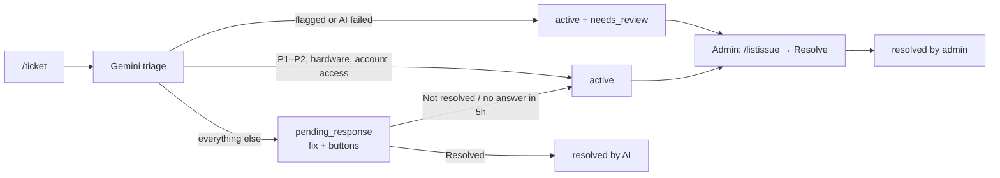
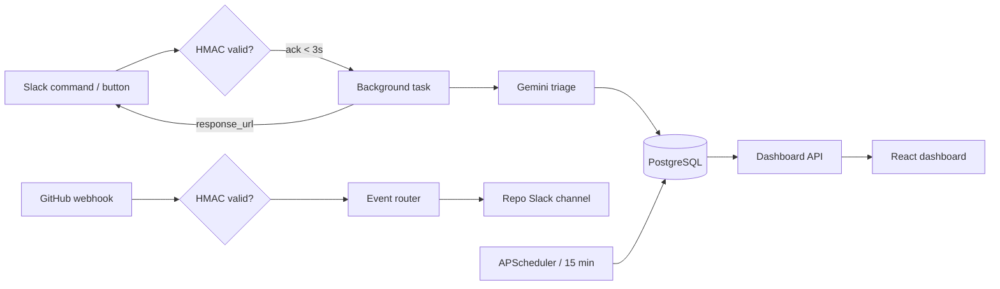

# ResolveOps

**An AI-triaged IT helpdesk and DevOps notifier that lives inside Slack.**

Employees file issues with a slash command. Gemini classifies, prioritizes, and suggests a fix in seconds. Simple issues are offered a self-service fix with **Resolved / Not resolved** buttons, and anything the fix doesn't solve goes to IT support. A background SLA engine escalates anything left unresolved, and a live dashboard shows how many tickets the AI solved on its own. GitHub activity (pushes, PRs, and CI runs) is posted to per-repo Slack channels.

**Live demo:** [Health check](https://resolveops.onrender.com/api/health) · [Join the Slack workspace](https://join.slack.com/t/solver-g678160/shared_invite/zt-47kxbtf9z-je55g8UYaiSfeaDa2xQCLQ)
> Free-tier Render host: hit the health check first to wake it up (~30s cold start).

---

## Features

| | |
|---|---|
| **AI triage** | `/ticket <issue>` uses Gemini 2.5 Flash with a strict JSON response schema to assign a category, a priority (1–5), a flag, and a suggested fix. |
| **Self-service fixes** | Low-risk tickets (P3–P5, not hardware or account access) get the AI's suggested fix with **Resolved** / **Not resolved** buttons. Resolved closes the ticket as solved by the AI; Not resolved sends it to IT support. Urgent, hardware and account-access tickets go straight to IT. |
| **Interactive buttons** | Slack button clicks hit `/webhook/interactions`. Only the person who raised a ticket can answer its fix buttons, and a ticket that was already answered is ignored, so double clicks are safe. `/listissue` shows each ticket as a card with its own **Resolve** button. |
| **Pending-response timeout** | If the user never answers the fix buttons, the ticket is moved to IT support after 5 hours. |
| **Prompt-injection guard** | User text is wrapped in `<user_text>` tags and treated as untrusted data. The AI flags each ticket as `none`, `unclear`, `spam` or `injection`; flagged tickets skip the self-service fix and are marked `needs_review` for an admin. If the AI call fails, the ticket is flagged `ai_failed` and still reaches IT. |
| **SLA auto-escalation** | APScheduler runs every 15 minutes and bumps the priority of any ticket that breaches its window (P2: 2h, P3: 6h, P4: 12h, P5: 24h). |
| **Admin workflow** | `/listissue` (queue sorted by priority), `/resolve <id>`, and `/add-admin @user <admin_type>`, all gated by role checks against the database. |
| **Admin types** | Admins are `hardware`, `network`, `software`, `iam`, `other` or `super_admin`. Each admin only sees and resolves tickets in their own category; a `super_admin` sees every ticket and is the only one who can add admins. |
| **Live dashboard** | A React + Recharts dashboard shows the **AI deflection rate** (share of tickets solved by the AI fix with no admin), ticket counts, tickets by category and priority, the latest tickets, and the tickets caught by the AI guard. It refreshes every 10 seconds and supports light and dark mode. |
| **Abuse protection** | Users are auto-registered on first use, and each user has a daily cap on tickets. |
| **GitHub → Slack** | Push, pull request, and `workflow_run` events are routed to each repo's Slack channel as Block Kit cards with a link back to GitHub. |
| **Request security** | HMAC verification of Slack signatures (with replay protection) and GitHub `X-Hub-Signature-256`. Invalid requests get a 403. |
| **Built for Slack's 3s limit** | Every webhook acknowledges immediately. The slow work (AI calls, database, Slack API) runs in background tasks and replies through `response_url`. |
| **Schema migrations** | Alembic manages the database schema. Check constraints keep `flag` to its valid values and only allow `resolved_by` on resolved tickets. |

## Ticket Lifecycle



## Slack Commands

| Command | Who | What it does |
|---|---|---|
| `/ticket <issue>` | Anyone | Raise a ticket. The AI triages it and replies with a fix or a confirmation. |
| `/listissue` | Admins | Active tickets for your admin type, sorted by priority, each with a **Resolve** button. |
| `/resolve <id>` | Admins | Resolve a ticket by ID. |
| `/add-admin @user <admin_type>` | `super_admin` | Make a user an admin of the given type. |

Slack sends slash commands as form-encoded fields (`user_id`, `user_name`, `text`, `response_url`). Button clicks arrive at `/webhook/interactions` as a form field `payload` that holds the JSON. Example payloads for Slack interactions and GitHub events are in [`payloadformats.md`](payloadformats.md).

## Dashboard API

| Endpoint | Returns |
|---|---|
| `GET /api/dashboard/overview` | Everything the dashboard shows in one request: `kpis` (total, open, solved_by_ai, deflection_rate, needs_review), `by_category`, `by_priority`, the 10 most `recent` tickets, and the `flagged` tickets. |
| `GET /api/dashboard/todays-tickets` | Tickets raised since midnight UTC, newest first. |
| `GET /api/dashboard/ai-solved-tickets` | The latest tickets the AI fix solved. |
| `GET /api/dashboard/summary` | Total, solved, unsolved and AI-solved counts. |

## Tech Stack

**Backend:** Python, FastAPI, Uvicorn, httpx (async)  
**Frontend:** React, Vite, Recharts  
**Data:** PostgreSQL, SQLAlchemy, Alembic, Pydantic  
**AI:** Google Gemini 2.5 Flash (structured output)  
**Automation:** APScheduler  
**Integrations:** Slack Slash Commands, Interactivity and Web API, GitHub Webhooks  
**Testing / Deploy:** Pytest, Render

## Architecture



## Project Structure

```
backend/
├── main.py          # Routes, Slack interactions, GitHub event router, scheduler lifecycle
├── ai.py            # Gemini prompt, schema-enforced triage, injection guard
├── sla.py           # SLA escalation + pending-response timeout jobs
├── crud.py          # DB ops, background workers, fix feedback
├── slack_blocks.py  # Slack Block Kit message builders and button action IDs
├── auth.py          # Slack/GitHub signature checks, admin RBAC
└── models.py / schemas.py / database.py
backendapi/
├── queries/ticket_queries.py     # Dashboard ticket queries
└── routes/dashboard_routes.py    # /api/dashboard/* endpoints
frontend/src/
├── App.jsx          # Dashboard page, polls /api/dashboard/overview
├── api.js           # Backend calls
├── index.css        # Colour tokens (light + dark) and page layout
└── components/      # Navbar, StatCard, Panel, BarChartCard, TicketList, Badge (each with its own CSS)
alembic/             # Database migrations
testing/
├── create_test_db.py      # Builds the SQLite test database from the models
├── test_ai_response.py    # Gemini triage output shape, category and flag (marked `ai`, calls the real API)
├── test_crud.py           # Ticket insertion, user auto-registration, failure handling
└── test_admin_tickets.py  # Admin role checks for /resolve and /listissue
payloadformats.md    # Example Slack and GitHub payloads
```

## Quick Start

```bash
git clone https://github.com/<your-username>/ResolveOps.git && cd ResolveOps
pip install -r requirements.txt
# .env → DATABASE_URL, GEMINI_API, BOT_AUTH_TOKEN, SIGNING_SECRET, GITHUB_SECRET
alembic upgrade head
uvicorn backend.main:app --reload

python -m testing.create_test_db
pytest testing/

cd frontend && npm install && npm run dev   # dashboard on http://localhost:5173
```

In your Slack app, point the slash commands at `/webhook/{ticket,listissue,resolve,add-admin}` and **Interactivity & Shortcuts** at `/webhook/interactions`. Point the GitHub webhook at `/webhook/github` (push, PR, and workflow run events).

Set `VITE_API_URL` in the frontend if the backend is not on `http://localhost:8000`, and `FRONTEND_URL` in the backend if the dashboard is not on `http://localhost:5173`.

## Roadmap

- Async SQLAlchemy / `asyncpg` so database calls don't block the event loop
- Move the scheduler to a dedicated worker for horizontal scaling
- Mocked unit tests and CI on every push
- Track `resolved_at` to report mean time to resolve on the dashboard

---

Built by **Jairam Hegde**
